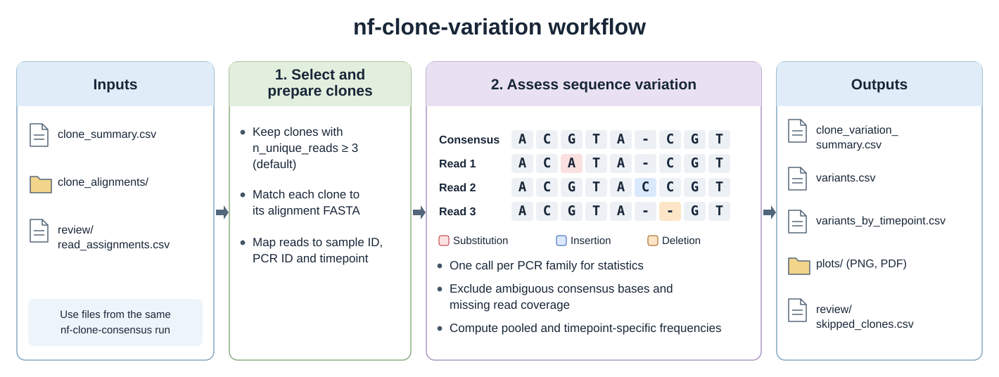

# nf-clone-variation

A Nextflow pipeline for visualizing and quantifying within-clone HIV sequence variation relative to the clone consensus, including changes in variant frequency over time.

It uses outputs from [nf-clone-consensus](https://github.com/ekankaka/nf-clone-consensus), which in turn uses outputs from [nf-viral-integration](https://github.com/connor122721/nf-viral-integration). No realignment is performed.

## Requirements

- Nextflow and Java (tested with Nextflow 25.10.4 and Java 17)
- Docker, Singularity or Apptainer; alternatively, Python 3.10+ and Matplotlib for native execution
- SLURM for HPC execution

## Inputs

Use the following outputs from the same run of nf-clone-consensus.

| Required parameter | Input |
|---|---|
| `--input` | `clone_summary.csv` |
| `--clone_alignment_folder` | `clone_alignments/` |
| `--read_assignments` | `review/read_assignments.csv` |

Each alignment must begin with the clone consensus and be named `<consensus_header>_alignment.fasta` or `<consensus_header>.fasta`.

| Optional parameter | Default | Description |
|---|---|---|
| `--min_unique_reads` | 3 | Minimum distinct PCR families (at least 3) |
| `--min_family_fraction` | 0.60 | Within-family agreement threshold (>0.5 to 1); match the upstream setting if changed |
| `--outdir` | `results` | Output directory |

## Run

```bash
git clone https://github.com/ekankaka/nf-clone-variation.git
cd nf-clone-variation
```

### Local test

```bash
nextflow run main.nf \
    --input tests/data/clone_summary.csv \
    --clone_alignment_folder tests/data/clone_alignments \
    --read_assignments tests/data/read_assignments.csv \
    --outdir results_test \
    -profile local,docker
```

Use `-profile local,singularity` or `-profile local,apptainer` for other container engines, or `-profile local` for native execution with Python and Matplotlib installed.

### HPC (SLURM and Singularity)

```bash
nextflow run main.nf \
    --input /path/to/results/clone_summary.csv \
    --clone_alignment_folder /path/to/results/clone_alignments \
    --read_assignments /path/to/results/review/read_assignments.csv \
    --outdir /path/to/variation_results \
    -profile slurm,singularity \
    -c /path/to/hpc.config \
    -resume
```

Keep HPC-specific settings in an external configuration file. Work and container cache directories must be accessible from compute nodes. Use `-profile slurm,apptainer` for Apptainer.

## Method



Clones with at least three distinct PCR families are analyzed by default. Substitutions, insertions and deletions are identified relative to the aligned consensus. Ambiguous consensus bases and missing read coverage are excluded. Quantitative results use one call per PCR family (sample_id + PCR_ID) and require at least two informative families at each evaluated locus. Plots show all reads, including PCR duplicates.

## Outputs

| File or directory | Description |
|---|---|
| `clone_variation_summary.csv` | Original clone metadata plus coverage and length-normalized variation statistics |
| `variants.csv` | Variant alleles, coordinates, frequencies and supporting families |
| `variants_by_timepoint.csv` | Variant frequencies and coverage by timepoint |
| `plots/` | Per-clone PNG and PDF plots |
| `review/skipped_clones.csv` | Eligible clones that could not be analyzed, with reasons |

Clones with no detected differences remain in the summary. Variant frequencies are relative to the pooled consensus and do not establish new mutations or ongoing viral replication.

## Documentation

- [Data dictionary](docs/data_dictionary.md): output variables and denominators.
- [Methods and implementation notes](docs/methods.md): input specifications, analytical rules, limitations and tests.

Native end-to-end synthetic tests passed. Container and HPC execution have not yet been independently verified.

License: [MIT](LICENSE).
