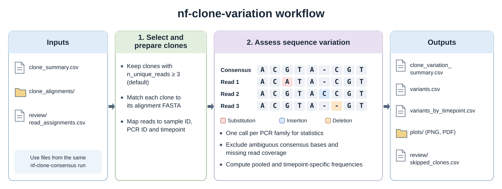

# Methods and implementation notes

## Input format

Use the three outputs from the same run of [nf-clone-consensus](https://github.com/ekankaka/nf-clone-consensus).

- `clone_summary.csv`: one row per clone. Required columns: `patient_id`, `clone_id`, `consensus_header`, `consensus_sequence`, `n_reads`, `n_unique_reads`.
- `clone_alignments/`: one aligned FASTA per clone. The pipeline first looks for `<consensus_header>_alignment.fasta`, then `<consensus_header>.fasta`. The first record must match the consensus header and its ungapped sequence must match `consensus_sequence`. The remaining records must match the assigned input reads. All records must have the same alignment width.
- `review/read_assignments.csv`: required columns are `patient_id`, `clone_id`, `fasta_header`, `sample_id`, `PCR_ID`, `timepoint` and `classification`. Only records classified as `CLONE` are used. The upstream reverse-complement annotation is removed from the alignment header when matching reads.

## Analytical method



*Illustrative alignment showing one substitution, insertion and deletion at distinct alignment columns.*

1. Select clones with at least three distinct PCR families by default (`--min_unique_reads`).
2. Verify the alignment and map each read to its sample, timepoint and PCR family.
3. Treat terminal gaps and ambiguous read bases as missing. Use A/C/G/T and internal gaps as informative calls. Mask ambiguous consensus bases, including N.
4. Collapse PCR duplicates to one call per (sample_id, PCR_ID) family per column using the minimum agreement fraction (default 0.60). Missing calls do not vote; insufficient agreement yields an ambiguous call.
5. Quantify substitutions and deleted bases at unambiguous consensus positions with at least two informative families. Count insertion alleles at internal consensus gap blocks with unambiguous flanks and at least two families spanning the junction.
6. Report fully resolved deletion events separately from per-base deletion burden. Exact event frequencies require at least two families with informative calls across the event and base calls at both flanks. Count contiguous deleted bases as one event; alternative inserted sequences are separate alleles.
7. Compute pooled and timepoint-specific frequencies using locus-specific family denominators. No coverage gives NA, not zero. Retain singleton variants at evaluable loci and report independent support.
8. Plot all input reads, including PCR duplicates, ordered by timepoint, sample and family. Show raw substitutions, internal gaps and candidate insertions, followed by family-level variant frequencies and coverage. For clones with reported variants and at least two timepoints, also plot exact-allele frequencies over time (one panel per allele, with missing coverage shown as gaps).

Plots use 1-based alignment columns. Tables also include ungapped consensus positions. The frequency panel shows per-column difference frequencies, not exact multi-base indel allele frequencies. Raw read differences may not survive family-level filters. Numeric timepoints sort numerically; other labels sort lexically.

See the [data dictionary](data_dictionary.md) for field definitions and normalization denominators.

## Interpretation and limitations

The pooled consensus is a comparison sequence, not an ancestral sequence. Variants are differences relative to that consensus, not necessarily new mutations. A PCR family is a proxy for an independently sampled template, not necessarily a distinct infected cell or unique nucleotide sequence.

Ambiguous consensus positions are deliberately excluded, even if they contain true polymorphism. Internal gaps may reflect alignment artifacts; indels are not left-normalized across repetitive sequences. Exact deletion events that cannot be bounded are excluded from the event table but their evaluable deleted bases contribute to base burden. FASTA lacks quality scores; technical artifacts cannot be ruled out. PCR-family support is not proof of biological variation. Longitudinal comparisons require adequate coverage at each timepoint and confirmation of ART suppression using clinical data. No inference of viral replication or mutation rate is made by this pipeline.

## Testing

The synthetic input includes a six-read clone with five independent families, two timepoints, a PCR duplicate, a terminal fragment, a masked base, one substitution, one two-base insertion and one two-base deletion supported by two families. A second clone is invariant; a third eligible clone is missing its alignment; a fourth is below the threshold.

Run the analysis and merge tests with Python and Matplotlib:

```bash
python tests/test_variation.py
```

After running the synthetic Nextflow example in the README, verify its outputs:

```bash
python tests/test_variation.py results_test
```

GitHub Actions checks the Python analysis, native Nextflow execution, longitudinal plot generation and publication, missing-coverage gaps, and the case with no eligible clones.

## Execution environment

The configured container is `quay.io/jupyter/scipy-notebook:python-3.12`, which is intended to provide Python and Matplotlib. For reproducible production runs, use a verified immutable container digest in an external configuration. Native execution was tested with Nextflow 25.10.4 and Python 3.12; container and SLURM execution should be verified in the target environment.
